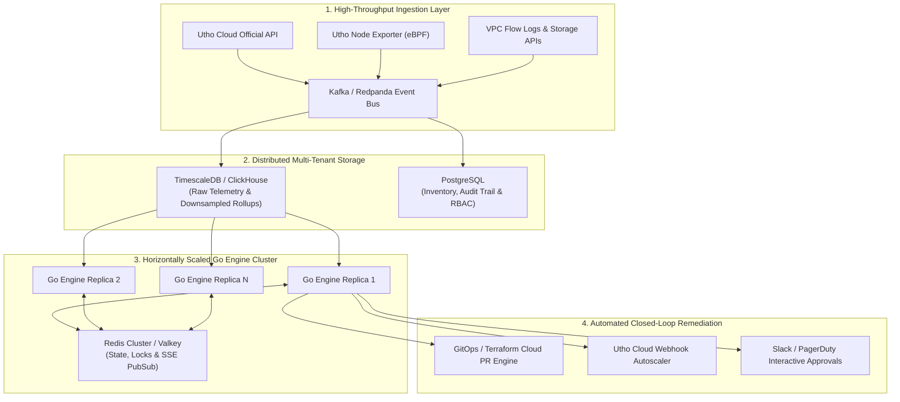

# SmartCloud Optimizer 🇮🇳

**Enterprise Cloud Rightsizing, FinOps Intelligence & Anomaly Detection Platform for Utho Cloud**

[](https://golang.org)
[](https://nextjs.org)
[](https://fastapi.tiangolo.com)
[](https://www.docker.com)
[-8E75C2?style=flat&logo=google)](https://ai.google.dev)
[-FF9933?style=flat)](https://utho.com)

SmartCloud Optimizer is an enterprise-grade cloud infrastructure rightsizing, FinOps governance, and live anomaly detection platform engineered natively for **Utho Cloud** (India's premier sovereign cloud provider). Built for infrastructure engineers, FinOps practitioners, and executive leadership at high-growth Indian tech enterprises, SmartCloud Optimizer eliminates cloud sprawl, enforces peak-safe rightsizing bounds, dynamically recalculates fleet financials in sub-milliseconds, and detects acute operational anomalies via streaming telemetry.

---

## 📑 Table of Contents

- [Executive Summary & Problem Statement](#-executive-summary--problem-statement)
- [System Architecture](#-system-architecture)
- [Comprehensive Tech Stack](#-comprehensive-tech-stack)
- [Core Platform Features](#-core-platform-features)
  - [1. Peak-Safe Rightsizing Engine ($P_{99} \le 72\%$)](#1-peak-safe-rightsizing-engine-p_99-le-72)
  - [2. Sub-Millisecond Dynamic FinOps Recalculation](#2-sub-millisecond-dynamic-finops-recalculation)
  - [3. Interactive Before vs. Projected After Visualizations](#3-interactive-before-vs-projected-after-visualizations)
  - [4. Time-Warp Streaming Telemetry & 1-Click Anomaly Simulator](#4-time-warp-streaming-telemetry--1-click-anomaly-simulator)
  - [5. Sub-150ms What-If Policy Simulation Engine](#5-sub-150ms-what-if-policy-simulation-engine)
  - [6. Tri-Persona Adaptive Intelligence](#6-tri-persona-adaptive-intelligence)
  - [7. Indian Sovereign Cloud & ESG Carbon Ledger](#7-indian-sovereign-cloud--esg-carbon-ledger)
  - [8. eDIth AI Telemetry Assistant (Gemini Flash)](#8-edith-ai-telemetry-assistant-gemini-flash)
- [Setup & Execution Guide](#-setup--execution-guide)
  - [Prerequisites](#prerequisites)
  - [Environment Variables](#environment-variables)
  - [Single-Command Local Startup](#single-command-local-startup)
  - [Individual Service Execution](#individual-service-execution)
  - [Docker & Containerized Deployment](#docker--containerized-deployment)
- [API Reference & Endpoint Contracts](#-api-reference--endpoint-contracts)
- [Directory Layout](#-directory-layout)
- [Inputs on Future Scalability & Production Roadmap](#-inputs-on-future-scalability--production-roadmap)
  - [1. Production Utho Cloud Provider Adapter](#1-production-utho-cloud-provider-adapter)
  - [2. Distributed Multi-Tenant Time-Series Storage](#2-distributed-multi-tenant-time-series-storage)
  - [3. High-Throughput Event Streaming Pipeline](#3-high-throughput-event-streaming-pipeline)
  - [4. Stateless Optimizer Horizontal Scaling](#4-stateless-optimizer-horizontal-scaling)
  - [5. Closed-Loop Automated Remediation & GitOps](#5-closed-loop-automated-remediation--gitops)
  - [6. Autonomous Multi-Agent FinOps Swarm](#6-autonomous-multi-agent-finops-swarm)
  - [7. Multi-Cloud Sovereign Federation](#7-multi-cloud-sovereign-federation)
- [License & Acknowledgements](#-license--acknowledgements)

---

## 🎯 Executive Summary & Problem Statement

### The SaaS Cloud Paradox
Mid-to-large scale Indian SaaS organizations typically run hundreds of distributed instances across domestic availability zones (Noida, Mumbai, Bangalore). In the baseline enterprise simulation analyzed by this platform:
* **Current Footprint:** 105 active cloud resources (75 compute VMs, 18 NVMe block volumes, 12 public IPs).
* **Current Run-Rate:** **₹5,97,000/month** (~₹71.6 Lakhs annually).
* **The Cost Creep:** Cloud spend grew by **+41.2% over 6 months** due to forgotten staging VMs, overprovisioned production clusters, detached unattached storage volumes, and unreleased elastic IPs.
* **The Naive Downsizing Trap:** Traditional FinOps tools average utilization over 30 days. When an engineer naively downsizes a payment settlement service because its average CPU is 14%, the service crashes during the daily 19:00–21:00 IST peak surge when CPU demand hits 88%.

### The Solution: SmartCloud Optimizer
SmartCloud Optimizer guarantees that **no recommendation will ever trigger a performance degradation or outage**. By enforcing strict $P_{95}$ and $P_{99}$ mathematical peak thresholds, the engine unlocks **₹2,94,400/month (49.3%) in recoverable monthly savings** (₹35.3 Lakhs annually) with zero risk to production stability.

---

## 🏛️ System Architecture

SmartCloud Optimizer follows a high-performance decoupled three-tier architecture:

```text
┌──────────────────────────────────────────────────────────────────────────────────────────────────┐
│                                     SMARTCLOUD OPTIMIZER                                         │
└──────────────────────────────────────────────────────────────────────────────────────────────────┘
                                                  │
            ┌─────────────────────────────────────┼─────────────────────────────────────┐
            ▼                                     ▼                                     ▼
 ┌──────────────────────────────┐      ┌──────────────────────────────┐      ┌──────────────────────────────┐
 │ SERVER 1: UTHO INFRA SIM     │      │ SERVER 2: OPTIMIZER ENGINE   │      │ TIER 3: FRONTEND DASHBOARD   │
 │ (Python FastAPI • Port 8001) │      │ (Golang 1.22+ • Port 8002)   │      │ (Next.js 14 • Port 3000)     │
 ├──────────────────────────────┤      ├──────────────────────────────┤      ├──────────────────────────────┤
 │ • 105 Utho Cloud Resources   │      │ • Zero-Dependency Go Core    │      │ • App Router & React 18      │
 │ • 8 Workload Archetypes      │      │ • Thread-Safe In-Memory State│      │ • Tailwind & Lucide Icons    │
 │ • 30-Day (2880 Ticks) Series │      │ • Sub-ms Financials Engine   │      │ • Dynamic Recharts Dual-Line │
 │ • 6-Month Billing History    │      │ • High-Concurrency SSE Stream│      │ • Draggable eDIth HUD Widget │
 │ • 5-sec Time-Warp Emitter    │      │ • Sub-150ms What-If Sim      │      │ • Tri-Persona Role Switcher  │
 │ • 1-Click Anomaly Injector   │      │ • Direct Gemini Flash Client │      │ • Instant IaC/CLI Exporters  │
 └──────────────────────────────┘      └──────────────────────────────┘      └──────────────────────────────┘
                │                                     ▲                                     ▲
                │      POST /api/internal/ingest-tick │                                     │
                └─────────────────────────────────────┘             GET /api/stream (SSE)   │
                                                                    ────────────────────────┘
                                                      │
                                                      ▼
                                       ┌──────────────────────────────┐
                                       │ eDIth AI TELEMETRY COPILOT   │
                                       │ (Google Gemini Flash Engine) │
                                       ├──────────────────────────────┤
                                       │ • Enterprise Diagnostics Hub │
                                       │ • Grounded on Live Telemetry │
                                       │ • Strict Domain Guardrails   │
                                       │ • Zero Hallucination FinOps  │
                                       └──────────────────────────────┘
```

### Communication Flow:
1. **Telemetry Generation & Emission:** Server 1 simulates 105 realistic VMs, volumes, and IPs. Every 5 real-world seconds, its Time-Warp engine advances simulated time by +15 minutes and emits a batch telemetry tick to Server 2 via HTTP `POST /api/internal/ingest-tick`.
2. **Streaming & State Synchronization:** Server 2 (Go) receives the tick, updates its lock-free telemetry cache, checks for anomalies, and broadcasts the event via an HTTP Server-Sent Events (SSE) channel to all active browser sessions connected to `GET /api/stream`.
3. **Dynamic FinOps Recalculation:** When an operator accepts or rejects a recommendation on the frontend, Server 2 updates the state in-memory and recalculates the entire fleet's spend, savings, and ESG carbon offsets in $<1\text{ ms}$.
4. **AI Reasoning with eDIth:** When an operator asks a question, Server 2 builds a context envelope with real-time fleet metrics and streams it directly to Google's Gemini Flash endpoint, returning analytical guidance in $\sim 2.1\text{ seconds}$.

---

## 💻 Comprehensive Tech Stack

### 1. Frontend Layer (`frontend/`)
* **Framework:** [Next.js 14.2](https://nextjs.org/) (React 18, App Router architecture).
* **Styling & Design System:** [Tailwind CSS](https://tailwindcss.com/) with a custom sovereign Utho Cloud dark theme (`#070B14`, `#0B132B`, `#00D2A0`, `#4F46E5`).
* **Interactive Visualizations:** [Recharts](https://recharts.org/) for dual-line before/after rightsizing projections, 6-month spend history, and regional cost distribution.
* **Component Toolkit:** [Lucide React](https://lucide.dev/) for crisp iconography; [Canvas Confetti](https://www.npmjs.com/package/canvas-confetti) for celebratory milestone triggers.
* **Streaming Client:** Browser-native `EventSource` listening to `/api/stream` for real-time telemetry updates.

### 2. Optimizer Engine Server (`optimizer-engine-server/`)
* **Core Language:** [Go 1.22+](https://golang.org/) (Pure standard library: `net/http`, `sync`, `encoding/json`, `os/exec`).
* **Routing Architecture:** Standard library `net/http.ServeMux` leveraging Go 1.22+ HTTP method matching and wildcards (`GET /api/resources/{id}/metrics`).
* **Concurrency Model:** Thread-safe `sync.RWMutex` state management with Go channels for non-blocking Server-Sent Events (SSE) broadcasting.
* **Performance Profile:** Sub-millisecond REST response times, $<15\text{ MB}$ memory footprint, instant compilation, zero Node.js or npm runtime dependency.
* **Analytics Bridge:** Asynchronous execution bridge to Python analytics routines for compute-heavy OLS linear regressions and Z-score calculations.
* **Direct Gemini Client:** High-speed HTTP client with connection pooling that interacts directly with Google's Generative AI REST API with automatic multi-model fallback (`gemini-flash-lite-latest` $\rightarrow$ `gemini-3.1-flash-lite` $\rightarrow$ `gemini-3.5-flash`).

### 3. Infrastructure & Telemetry Simulator (`utho-infra-server/`)
* **Framework:** [FastAPI](https://fastapi.tiangolo.com/) + [Uvicorn](https://www.uvicorn.org/) on Python 3.11+.
* **Mathematical Core:** [NumPy](https://numpy.org/), [Pandas](https://pandas.pydata.org/), and [SciPy](https://scipy.org/) for vectorized 30-day time-series generation (2,880 data points per VM $\times$ 75 VMs = 216,000 telemetry points generated in $<400\text{ ms}$).
* **Workload Archetype Engine:** 8 deterministic workload generators simulating diurnal enterprise cycles, weekend idle dips, batch nightly ETL jobs, zombie idle VMs, memory leaks, and high-frequency noise.
* **Time-Warp Background Ticker:** Asynchronous `asyncio` task advancing time by +15 minutes every 5 seconds.

### 4. Containerization & DevOps
* **Docker Multi-Stage Builds:** Lightweight Alpine and Slim images (`golang:1.24-alpine`, `python:3.11-slim`, `node:20-alpine`).
* **Docker Compose:** Unified multi-container orchestration with resource limits and health checks.

---

## ⚡ Core Platform Features

### 1. Peak-Safe Rightsizing Engine ($P_{99} \le 72\%$)
Traditional cloud cost tools use arithmetic means, creating dangerous blind spots. SmartCloud Optimizer enforces mathematical peak-safety guarantees:

$$\hat{P}_{99,\text{cpu}}(C_{\text{cand}}) = P_{99,\text{cpu}} \times \left(\frac{v_{\text{curr}}}{v_{\text{cand}}}\right) \le 72\%$$

* **Peak-Protected Lock:** If a candidate downsized instance causes projected $P_{99}$ CPU utilization to exceed **72%** (or RAM utilization to exceed **80%**), the recommendation is strictly blocked and flagged as **"Peak-Protected"**.
* **Visual Headroom Proof:** The UI provides an interactive toggle: *"Simulate Naive Downsize"*. Clicking this displays a red projected curve spiking to 180% CPU, proving to the engineer exactly why the instance must not be downsized.

### 2. Sub-Millisecond Dynamic FinOps Recalculation
* **Zero Database Bottleneck:** All fleet metrics, recommendations, and status toggles reside in thread-safe Go memory (`sync.RWMutex`).
* **Instantaneous Ripple Effect:** When an operator accepts a recommendation (or clicks *"1-Click Accept All Low-Risk"*):
  * Current spend remains locked at ₹5,97,000.
  * Projected spend immediately drops by the exact saving delta (e.g. down to ₹5,81,000 for a ₹16,000/mo volume cleanup).
  * Environment-specific counters (Prod, Staging, Dev) update instantly.
  * ESG sustainability counters update immediately in the top navigation bar.

### 3. Interactive Before vs. Projected After Visualizations
* **Dual-Line Drill-Down Charts:** In the Resource Drawer, historical telemetry (solid line) is rendered alongside the simulated post-rightsizing telemetry (dashed line).
* **Headroom Ceilings:** Visual threshold indicators at 70% (Safe Target) and 75% (Danger Zone) confirm whether downsized workloads will remain stable under peak traffic.

### 4. Time-Warp Streaming Telemetry & 1-Click Anomaly Simulator
* **Time-Warp Progression:** Advances the simulated cloud timeline by 15 minutes every 5 seconds. Telemetry is streamed to all connected clients over SSE.
* **1-Click Anomaly Simulator:** Clicking *"Simulate Live Anomaly"* injects a severe synthetic spike into `vm-ban-prod-anom-01`:
  * CPU spikes from $18\% \rightarrow 94.5\%$.
  * Network egress explodes from $12\text{ Mbps} \rightarrow 148.5\text{ Mbps}$.
  * The anomaly is detected via moving Z-score ($\mu + 3\sigma$) and pushed via SSE to trigger an instant warning toast and alert card on the dashboard in $<2\text{ seconds}$.

### 5. Sub-150ms What-If Policy Simulation Engine
Operators can model fleet-wide governance rules before applying changes:
* **Dev/Staging Off-Hours Shutdown:** Simulates stopping non-production workloads outside 08:00–20:00 IST and on weekends (eliminates ~68% of non-prod cost).
* **Target Peak Headroom Ceiling:** Interactive slider from 60% (Ultra Conservative) to 85% (Aggressive FinOps).
* **Unattached Volume Retention:** Adjusts pruning threshold for orphan storage from 7 days to 60 days.
* **Idle Public IP Release:** Reclaims Utho IPv4 hoarding penalties (₹350/mo per unattached IP).
* **Live Calculation:** The Go engine recalculates potential savings, affected resource counts, and risk distribution in $<50\text{ ms}$.

### 6. Tri-Persona Adaptive Intelligence
The platform includes an instant role-switching mechanism that tailors the interface for three key stakeholders:
* 🛠️ **Infrastructure Engineer:** Displays P99 peak headroom, IOPS, network outbound rates, generated Terraform snippets, and Utho CLI commands.
* 📈 **FinOps Practitioner:** Focuses on 6-month bill creep (+41.2%), waste categorization (idle compute, unattached storage, abandoned IPs), and unit economics.
* 💼 **Executive Leadership:** Emphasizes monthly run-rate reduction, total annual savings (₹35.3 Lakhs), overall fleet risk profile, and ESG carbon reduction.

### 7. Indian Sovereign Cloud & ESG Carbon Ledger
* **Geographic Alignment:** Optimized for Utho Cloud availability zones: **Noida (Delhi NCR)**, **Mumbai**, and **Bangalore**.
* **Currency:** Native Indian Rupee (`INR` / `₹`) formatting throughout.
* **ESG Sustainability Model:** Translates compute reductions into environmental metrics using Indian power grid benchmarks:
  $$\text{kWh Saved} = \Delta \text{Watts} \times 730\text{ hrs} \times \text{PUE}_{\text{Utho}} (1.38)$$
  $$\text{CO}_2\text{e (kg)} = \text{kWh Saved} \times 0.71\text{ kg CO}_2/\text{kWh (CEA 2024)}$$
  $$\text{Trees Planted Equivalent} = \frac{\text{CO}_2\text{e (kg)}}{21.77\text{ kg/tree/year}}$$

### 8. eDIth AI Telemetry Assistant (Gemini Flash)
Named **eDIth** (*Enterprise Diagnostics & Infrastructure Telemetry Hub*), the assistant is embedded as a draggable, dark-mode floating HUD widget:
* **Live Grounding:** Grounded directly on the 105 Utho Cloud resources, 6-month billing trends, and P99 peak thresholds.
* **Strict Guardrails:** Programmed with enterprise guardrails that reject out-of-context queries (e.g. recipes, general coding) and focus exclusively on FinOps, telemetry diagnostics, and infrastructure optimization.
* **Low Latency:** Powered by Google's high-speed Gemini Flash models (`gemini-flash-lite-latest`), delivering detailed, grounded responses in $\sim 2$ seconds.
* **Draggable UX:** Custom mouse event listener allows dragging the widget anywhere on the screen without obstructing underlying dashboard metrics.

---

## 🛠️ Setup & Execution Guide

### Prerequisites
Before running SmartCloud Optimizer, ensure your machine has:
* **Go**: `1.22` or higher (`go version`)
* **Python**: `3.10` or higher (`python3 --version`)
* **Node.js**: `18.0` or higher (`node -v`)
* **Docker & Docker Compose** (optional, for containerized run)

---

### Environment Variables
Copy `.env.example` to `.env` in the project root:

```bash
cp .env.example .env
```

| Variable | Description | Default | Required? |
|---|---|---|---|
| `GEMINI_API_KEY` | Google AI Studio API Key for eDIth | `""` | Optional (Required for AI Chat) |
| `GEMINI_MODEL` | Gemini model identifier | `gemini-flash-lite-latest` | Optional |
| `PORT` | Go Optimizer server port | `8002` | Optional |
| `INFRA_PORT` | Python Infra server port | `8001` | Optional |
| `NEXT_PUBLIC_API_URL` | Optimizer backend URL for frontend | `http://localhost:8002` | Required for Next.js |
| `NEXT_PUBLIC_INFRA_URL` | Infra server URL for frontend | `http://localhost:8001` | Required for Next.js |

> [!TIP]
> Get a free Gemini API key from [Google AI Studio](https://aistudio.google.com/).

---

### Single-Command Local Startup
You can launch the entire stack using the root runner:

```bash
# 1. Install root dependencies (concurrently)
npm install

# 2. Setup Python virtual environment
python3 -m venv .venv
source .venv/bin/activate
pip install -r utho-infra-server/requirements.txt

# 3. Install frontend dependencies
cd frontend && npm install && cd ..

# 4. Start all three services concurrently
npm run dev
```

This single command boots:
* 🟣 **Utho Infra Server:** `http://localhost:8001`
* 🔵 **Go Optimizer Engine:** `http://localhost:8002`
* 🟢 **Next.js Web Frontend:** `http://localhost:3000`

---

### Individual Service Execution
If you prefer running the components in separate terminal windows:

**Terminal 1 — Infra Simulator (Python):**
```bash
cd utho-infra-server
source ../.venv/bin/activate
uvicorn main:app --host 0.0.0.0 --port 8001
```

**Terminal 2 — Optimizer Engine (Go):**
```bash
cd optimizer-engine-server
go run .
```

**Terminal 3 — Frontend Dashboard (Next.js):**
```bash
cd frontend
npm run dev
```

---

### Docker & Containerized Deployment
To run the full stack inside isolated Docker containers:

```bash
# Build and start all services in detached mode
docker compose up -d --build

# View real-time container logs
docker compose logs -f

# Shut down containers
docker compose down
```

* The containerized frontend will be available at **`http://localhost:3001`**.
* The Go optimizer server runs at **`http://localhost:8002`**.
* The Python infra server runs at **`http://localhost:8001`**.

---

## 📡 API Reference & Endpoint Contracts

### Utho Infra Server (`:8001`)

| Endpoint | Method | Description | Sample Output |
|---|---|---|---|
| `/health` | `GET` | Service health status and resource count | `{"status":"healthy","resources_count":105}` |
| `/infra/inventory` | `GET` | Complete inventory of all 105 Utho cloud resources | List of `Resource` objects |
| `/infra/metrics` | `GET` | 30-day 15-minute time series data (2,880 points/VM) | `{"metrics":{...}}` |
| `/infra/billing-history` | `GET` | 6-month historical billing breakdown with annotations | List of monthly totals by environment |
| `/sim/trigger-anomaly` | `POST` | Injects synthetic CPU/Network spike into target node | `{"success":true,"resource_id":"vm-ban-prod-anom-01"}` |

---

### Optimizer Engine Server (`:8002`)

| Endpoint | Method | Description |
|---|---|---|
| `GET /health` | `GET` | Verifies Go engine status, cache readiness, and SSE client count |
| `GET /api/overview` | `GET` | Fleet summary: dynamic spend, projected savings, ESG metrics, billing trends |
| `GET /api/resources` | `GET` | All resources annotated with $P_{50}, P_{95}, P_{99}$ metrics & health flags |
| `GET /api/resources/{id}/metrics` | `GET` | Detailed time-series metrics and simulated downsize curve for a specific VM |
| `GET /api/recommendations` | `GET` | Prioritized rightsizing and cleanup recommendations with peak-safety proof |
| `POST /api/recommendations/{id}/status` | `POST` | Updates recommendation status (`accepted`, `rejected`, `pending`) |
| `POST /api/recommendations/bulk-status` | `POST` | Batch accepts or resets recommendations (e.g. *"Accept All Low-Risk"*) |
| `POST /api/what-if` | `POST` | Simulates policy adjustments in $<50\text{ ms}$ (auto-stop, retention, headroom) |
| `GET /api/alerts-and-forecast` | `GET` | Active anomaly alerts and 30-day OLS capacity creep projections |
| `GET /api/stream` | `GET` | Server-Sent Events (SSE) telemetry stream for real-time dashboard updates |
| `POST /api/internal/ingest-tick` | `POST` | Ingestion endpoint called by Server 1 on every Time-Warp tick |
| `POST /api/internal/ingest-anomaly` | `POST` | Ingestion endpoint for anomaly alerts from Server 1 |
| `POST /api/sim/trigger-anomaly` | `POST` | Proxy endpoint forwarding anomaly injection triggers to Server 1 |
| `POST /api/chat` | `POST` | Natural language interface with eDIth AI grounded on live fleet telemetry |

---

## 📂 Directory Layout

```text
smartcloud-optimizer/
├── .dockerignore
├── .gitignore
├── .env.example
├── README.md                            # Comprehensive Platform Documentation
├── docker-compose.yml                   # Production multi-container orchestrator
├── docker-compose.dev.yml               # Development override with hot-reloading
├── package.json                         # Root workspace script runner (concurrently)
│
├── utho-infra-server/                   # TIER 1: Telemetry & Infrastructure Simulator
│   ├── Dockerfile
│   ├── requirements.txt                 # FastAPI, Uvicorn, NumPy, Pandas, SciPy
│   ├── main.py                          # FastAPI server & Time-Warp background worker
│   ├── catalog.py                       # Utho VM tiers, pricing tables & ESG constants
│   ├── generator.py                     # Vectorized 30-day metrics & 6-month bill generator
│   └── data/                            # Auto-generated seed data cache
│
├── optimizer-engine-server/             # TIER 2: Analytics & Rightsizing Engine (Golang)
│   ├── Dockerfile                       # Multi-stage Go build
│   ├── go.mod                           # Go 1.22 module configuration
│   ├── main.go                          # HTTP server, routing mux & middleware
│   ├── state.go                         # Thread-safe in-memory cache & dynamic FinOps math
│   ├── handlers.go                      # REST API endpoint handlers
│   ├── sse.go                           # Thread-safe Server-Sent Events broker
│   ├── chatbot.go                       # eDIth Gemini AI integration & domain guardrails
│   ├── env.go                           # Zero-dependency .env file parser
│   ├── types.go                         # Domain models, financials & recommendation structs
│   └── analytics/                       # Statistical Python Worker
│       ├── requirements.txt
│       ├── engine.py                    # OLS regression, Z-score math & rightsizing logic
│       └── cli_runner.py                # Fast JSON CLI bridge called by Go engine
│
└── frontend/                            # TIER 3: Dashboard Web Application (Next.js 14)
    ├── Dockerfile                       # Multi-stage Node/Next.js standalone build
    ├── package.json
    ├── next.config.mjs
    ├── tailwind.config.ts
    ├── src/
    │   ├── app/                         # App Router (page.tsx, layout.tsx, globals.css)
    │   ├── components/
    │   │   ├── layout/                  # Navigation bar, persona switcher, time-warp status
    │   │   ├── dashboard/               # Executive summary KPIs, before/after cards
    │   │   ├── resources/               # Resource catalog & drill-down drawer with charts
    │   │   ├── recommendations/         # Recommendation cards, IaC modal, peak-safety proof
    │   │   ├── simulator/               # What-If policy sliders & delta visualizer
    │   │   ├── alerts/                  # Live anomaly alert feed & capacity forecasts
    │   │   ├── chat/                    # eDIth draggable floating AI HUD widget
    │   │   └── assumptions/             # Pricing catalog & ESG calculation transparent sheet
    │   └── lib/                         # API client, SSE hook, types & formatting helpers
```

---

## 🔮 Inputs on Future Scalability & Production Roadmap

SmartCloud Optimizer was intentionally architected with clear boundaries between data generation, state calculation, and presentation. As the platform transitions from an evaluation prototype to an enterprise production solution managing thousands of multi-region nodes, the following architectural evolutions are designed to scale the system seamlessly:



### 1. Production Utho Cloud Provider Adapter
* **Direct Cloud API Integration:** Replace the synthetic simulator (`utho-infra-server`) with an asynchronous collector utilizing Utho Cloud's official REST APIs (v2/cloud/servers, v2/cloud/volumes, v2/cloud/ips).
* **eBPF-Based Telemetry Daemon:** Deploy lightweight, non-intrusive eBPF agents (`utho-telemetry-agent`) directly onto customer VMs to collect sub-second CPU, memory page cache, NVMe queue depths, and socket-level network egress without incurring hypervisor overhead.

### 2. Distributed Multi-Tenant Time-Series Storage
* **ClickHouse / TimescaleDB Migration:** Transition from in-memory JSON cache to a columnar time-series database (ClickHouse or TimescaleDB).
* **Automated Data Downsampling:** Retain raw 1-minute telemetry for 14 days, auto-roll up into 1-hour $P_{50}/P_{95}/P_{99}$ buckets for 90 days, and archive 1-day summary aggregates for 3 years to ensure analytical speed at petabyte scale.
* **Row-Level Security & Tenant Isolation:** Enforce enterprise multi-tenancy with cryptographic tenant isolation across organizational units, environments, and business divisions.

### 3. High-Throughput Event Streaming Pipeline
* **Apache Kafka / Redpanda Ingestion:** Decouple telemetry ingestion from processing using Kafka or Redpanda partitioned by `organization_id` and `region_id`.
* **Out-of-Order Tick Handling:** Implement sliding-window stream processing with Apache Flink or Go-based stream consumers to gracefully handle delayed or re-transmitted network packets from remote cloud edges.

### 4. Stateless Optimizer Horizontal Scaling
* **Stateless Go Worker Nodes:** The Go optimizer engine (`optimizer-engine-server`) is designed to be completely stateless. Session and recommendation states can be persisted in a high-availability **Redis Cluster (or Valkey)**.
* **Distributed SSE Broadcasting:** Replace single-node Go channel broadcasting with **Redis Pub/Sub** or an enterprise WebSocket/SSE gateway (such as Centrifugo or AWS API Gateway), allowing millions of browser dashboards to receive live telemetry simultaneously.

### 5. Closed-Loop Automated Remediation & GitOps
* **Automated Pull Request Generation:** Instead of copying Terraform snippets manually, the engine integrates directly with GitHub, GitLab, and Bitbucket to automatically open pull requests modifying infrastructure-as-code repositories.
* **Approval Workflow Integrations:** 1-click approvals delivered directly into enterprise communication channels (**Slack**, **Microsoft Teams**, and **PagerDuty**) with two-man rule validation for critical production workloads.
* **Zero-Downtime Live Migration:** Integrate with Utho Cloud hypervisor APIs to perform live instance resizing (CPU/RAM hot-plugging) without requiring workload reboots.

### 6. Autonomous Multi-Agent FinOps Swarm
* **Specialized Autonomous Subagents:** Expand eDIth from a single conversational copilot into an autonomous multi-agent swarm:
  * *Storage Lifecycle Agent:* Continuously identifies snapshots and unattached volumes past retention boundaries and archives them to object storage.
  * *Commitment Planner Agent:* Analyzes steady-state baseline usage and models long-term reserved instance discounts versus on-demand billing.
  * *Egress Topology Agent:* Recommends internal private network routing configurations to eliminate cross-region and internet egress transit fees.

### 7. Multi-Cloud Sovereign Federation
* **Cross-Provider Indian Cloud Mesh:** Extend the engine's cost modeling catalog to encompass other sovereign Indian data center providers (e.g., Yotta, CtrlS, E2E Networks), providing hybrid multi-cloud rightsizing with unified billing and compliance verification under India's Digital Personal Data Protection (DPDP) Act.

---

## 📜 License & Acknowledgements

* **License:** Built under the MIT Open Source License.
* **Cloud Platform:** Designed around the architecture, API semantics, and region footprint of **[Utho Cloud](https://utho.com)** (Noida, Mumbai, Bangalore).
* **AI Engine:** Powered by **[Google Gemini](https://ai.google.dev)** Flash-Lite models.
* **Grid Data:** Indian carbon emission factors based on the **Central Electricity Authority (CEA) CO2 Baseline Database (Version 19, 2024)**.
